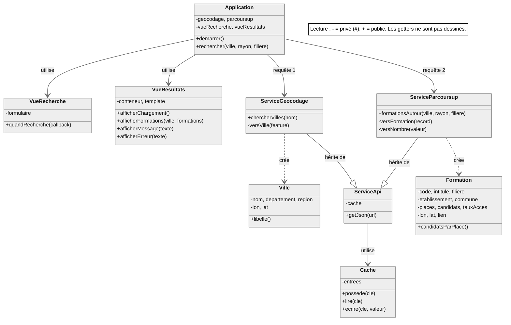

# Parcoursup Explorer : architecture proposée

Architecture proposée par une IA, à ma demande. **Le prof l'a autorisé à l'oral** : une IA peut proposer l'architecture, puis je dessine le diagramme moi-même (draw.io). Il a aussi autorisé l'IA à **donner le code**, à condition qu'elle l'explique **comme un prof** : à partir du cours et de la documentation MDN, en justifiant chaque choix. Le but de la SAE est d'aller loin pour apprendre.
👉 Je dois **comprendre et savoir expliquer** chaque classe et chaque ligne. La déclaration « Usage de l'IA » se décide à la fin de ce document (section 9).

**Précision du prof (11/10)** : pas besoin d'API de secours pour ce projet. Elle est donc retirée de l'architecture et des bonus.

---

## 1. Vue d'ensemble : 4 couches

```
┌──────────────────────────────────────────────────────────────┐
│  CONTRÔLEUR   Application                                    │  enchaîne les étapes
├──────────────────────────────────────────────────────────────┤
│  VUES         VueRecherche   VueResultats   (VueCarte …)     │  le DOM, les événements
├──────────────────────────────────────────────────────────────┤
│  SERVICES     ServiceApi ◄── ServiceGeocodage                │  les API : les SEULES classes
│                    ▲   ◄── ServiceParcoursup                 │  qui connaissent les URL et
│                    └──► Cache                                │  les noms de champs des API
├──────────────────────────────────────────────────────────────┤
│  MODÈLES      Ville   Formation                              │  MON format de données
└──────────────────────────────────────────────────────────────┘
```

**La règle qui guide tout** (conseil oral du prof : « dépendre de la structure, pas des API ») : **seuls les services connaissent les API.** Ils transforment chaque réponse en objets `Ville` ou `Formation`. Les vues et le contrôleur ne voient **jamais** `features[0].geometry.coordinates` ni `taux_acces_ens`.

---

## 2. Les classes de la partie obligatoire (9 classes)

### Modèles : mon format de données

#### `Ville` (`src/scripts/modeles/ville.js`)
Une commune, telle que mon application la représente.

| Attributs (privés `#`, lus par des getters) | Méthodes |
|---|---|
| `#nom` (ex. `Arles`) | `constructor ({ nom, departement, region, lon, lat })` |
| `#departement` (ex. `13`) | getters : `nom`, `departement`, `region`, `lon`, `lat` |
| `#region` (ex. `Provence-Alpes-Côte d'Azur`) | `get libelle ()` → `"Arles (13)"`, pour l'affichage |
| `#lon`, `#lat` | |

**Pourquoi ?** Le piège « [lon, lat] inversés = 0 résultat sans erreur » disparaît : on écrit `ville.lon` et `ville.lat`, et plus jamais `coordinates[0]`. La région servira au bonus Mon Master.

#### `Formation` (`src/scripts/modeles/formation.js`)
Une formation Parcoursup, avec des nombres **déjà convertis**.

| Attributs | Méthodes |
|---|---|
| `#code` (`cod_aff_form`, sert à l'historique) | `constructor ({ … })` |
| `#etablissement`, `#intitule`, `#commune`, `#filiere` | un getter par attribut |
| `#places`, `#candidats`, `#tauxAcces` (des **nombres**, ou `null` si inconnus) | `get candidatsParPlace ()` → ex. `26.6` |
| `#lon`, `#lat`, `#lien` (fiche Parcoursup) | |

**Pourquoi ?** Le taux d'accès arrive en `44`, `"52"` ou `59.0` selon l'année : on le convertit **une seule fois**, avant de créer la `Formation`. Le reste du code ne se pose plus la question.

### Services : la communication avec les API

#### `Cache` (`src/scripts/services/cache.js`)
| Attributs | Méthodes |
|---|---|
| `#entrees` : une **`Map`** (clé = URL, valeur = réponse JSON) | `possede (cle)`, `lire (cle)`, `ecrire (cle, valeur)` |

**Pourquoi ?** Le quota de Parcoursup est de 5 000 requêtes par jour et par IP (IP partagée à l'IUT). Les données ne changent qu'une fois par an : pas besoin de date d'expiration, la `Map` (chapitre 3) se vide quand on recharge la page. *(Bonus possible : la garder dans `localStorage`.)*

#### `ServiceApi` (`src/scripts/services/serviceApi.js`) : classe mère des services
| Attributs | Méthodes |
|---|---|
| `#cache` : un `Cache` | `constructor (cache)` |
| | `async getJson (url)` : regarde le cache → `fetch` → **teste `response.ok`** (sinon `throw new Error`) → `response.json()` → range dans le cache → renvoie le JSON |

**Pourquoi ?** Les deux services font **exactement la même chose** pour parler à leur API : `fetch`, vérifier `response.ok` (chapitre 5 : « fetch ne rejette pas sur 404 ou 500 »), lire le JSON, utiliser le cache. Ce code commun est écrit **une seule fois**, dans la classe mère, et les classes filles en **héritent** (`class … extends`, chapitre 3 ; héritage du chapitre 1). C'est la même idée que le composant `FTC` du chapitre 5, mais en classe.

#### `ServiceGeocodage extends ServiceApi` (`src/scripts/services/serviceGeocodage.js`)
| Méthodes |
|---|
| `async chercherVilles (nom)` → `Ville[]` : construit l'URL `https://data.geopf.fr/geocodage/search?q=…&type=municipality&limit=5` (avec `encodeURIComponent`), appelle `this.getJson(url)` (**héritée**), puis transforme chaque `feature` avec `#versVille` |
| `#versVille (feature)` (privée) : `coordinates[0]` → `lon`, `coordinates[1]` → `lat`, `context.split(', ')` → département et région |

Pas besoin d'écrire de constructeur : celui de `ServiceApi` est hérité. Elle se crée avec `new ServiceGeocodage(cache)`.

**Requête 1.** Une liste vide (ville inconnue : code 200) est renvoyée telle quelle. C'est l'`Application` qui décide quoi afficher.

#### `ServiceParcoursup extends ServiceApi` (`src/scripts/services/serviceParcoursup.js`)
| Méthodes |
|---|
| `async formationsAutour (ville, rayonKm, filiere)` → `Formation[]` : construit le `where` avec `within_distance(g_olocalisation_des_formations, geom'POINT(${ville.lon} ${ville.lat})', ${rayonKm}km)`, plus `fili='…'` si une filière est choisie, et `limit=100`, puis appelle `this.getJson(url)` (**héritée**) |
| `#versFormation (record)` (privée) : noms de l'API → mon format |
| `#versNombre (valeur)` (privée) : `44`, `"52"`, `59.0` → nombre ; `null` ou `""` → `null` |

**Requête 2, qui dépend de la requête 1** : elle reçoit une `Ville`, que seule la requête 1 peut fournir.

### Vues : le DOM et les événements

#### `VueRecherche` (`src/scripts/vues/vueRecherche.js`)
| Attributs | Méthodes |
|---|---|
| `#formulaire` (l'élément `<form>`) | `constructor (conteneur)` : insère le template `recherche.tpl.html` |
| | `quandRecherche (callback)` : `addEventListener('submit', …)`, `preventDefault()`, lit ville, rayon et filière, puis appelle `callback({ nomVille, rayonKm, filiere })` |

#### `VueResultats` (`src/scripts/vues/vueResultats.js`)
| Attributs | Méthodes |
|---|---|
| `#conteneur`, `#template` (template Handlebars compilé) | `constructor (conteneur)` |
| | `afficherChargement ()` |
| | `afficherFormations (ville, formations)` |
| | `afficherMessage (texte)` (ville introuvable, aucune formation) |
| | `afficherErreur (texte)` (problème réseau ou API) |

**Pourquoi 2 vues ?** Le formulaire et les résultats évoluent séparément. Les bonus ajouteront `VueCarte` et `VueHistorique` sans toucher aux deux premières.

### Contrôleur

#### `Application` (`src/scripts/application.js`)
| Attributs | Méthodes |
|---|---|
| `#geocodage`, `#parcoursup` | `constructor (geocodage, parcoursup, vueRecherche, vueResultats)` |
| `#vueRecherche`, `#vueResultats` | `demarrer ()` : `vueRecherche.quandRecherche((criteres) => this.rechercher(criteres))` |
| | `async rechercher ({ nomVille, rayonKm, filiere })` : **l'enchaînement des 2 requêtes** (voir section 3) |

#### `app.js` : l'assemblage (pas une classe)
Il crée les objets et les relie, puis démarre l'application. Concrètement : **un seul** `Cache`, donné aux deux services (`new ServiceGeocodage(cache)` et `new ServiceParcoursup(cache)`), les deux vues, puis `new Application(…)` et `.demarrer()`.
**Pourquoi ?** Les classes reçoivent ce dont elles ont besoin dans leur constructeur, au lieu de le créer elles-mêmes. Tous les objets sont créés à un seul endroit, et on voit d'un coup d'œil comment ils sont reliés.

---

## 3. L'enchaînement des 2 requêtes dépendantes

(Question obligatoire de la section « Choix de conception ».)

```
Utilisateur ── submit ──► VueRecherche ── callback({ nomVille, rayonKm, filiere }) ──► Application.rechercher
                                                                                            │
  vueResultats.afficherChargement()  ◄──────────────────────────────────────────────────────┤
                                                                                            │
  REQUÊTE 1   villes = await geocodage.chercherVilles(nomVille)                             │
              └─ ServiceGeocodage → getJson(URL IGN) → [cache ?] → fetch → Ville[]          │
                                                                                            │
  si villes.length === 0 → vueResultats.afficherMessage('Ville introuvable') ; fin          │
  ville = villes[0]                                                                         │
                                                                                            │
  REQUÊTE 2   formations = await parcoursup.formationsAutour(ville, rayonKm, filiere)       │
              └─ utilise ville.lon et ville.lat ◄── DÉPENDANCE : impossible sans la requête 1
              └─ getJson(URL Parcoursup) → [cache ?] → fetch → Formation[]                  │
                                                                                            │
  si formations.length === 0 → afficherMessage('Aucune formation dans ce rayon') ; fin      │
  vueResultats.afficherFormations(ville, formations)                                        │
                                                                                            │
  tout est dans un try / catch → en cas d'erreur réseau ou HTTP : afficherErreur(…)         │
```

Les deux `await` sont **l'un après l'autre** (et pas dans un `Promise.all`) **parce que** la 2ᵉ a besoin du résultat de la 1ʳᵉ. C'est exactement ce que montre le chapitre 5.

---

## 4. Les bonus, et ce qu'ils ajoutent

| Bonus | Nouvelles classes | Ce qui change ailleurs |
|---|---|---|
| Villes homonymes et debounce | rien | `VueRecherche` : liste de suggestions, `setTimeout` / `clearTimeout` (debounce du chapitre 5) |
| Carte | `VueCarte` (`#carte`, `#calque`, `afficherFormations(ville, formations)`) | `Application` appelle aussi `vueCarte.afficherFormations` |
| Historique | `StatistiqueAnnuelle` (`annee`, `places`, `candidats`, `tauxAcces`, `rangDernierAppele`) et `Historique` (`#annees`, `fourchette()`, `moyenne()`, `tendance()` → pente et R²) | `ServiceParcoursup.historique(code)` avec **`Promise.all`** sur 2022, 2023 et 2024 ; `VueHistorique` (Chart.js) |
| Mon Master | `Master` (modèle) et `ServiceMonMaster extends ServiceApi` (`mastersDeLaRegion(region, secteur)`, `historique(ifc)`) | `ville.region` sert enfin ; `VueMasters` |

**Ce que montrent ces bonus pour la note** : chaque bonus **ajoute** des classes au lieu de modifier celles qui existent. Par exemple, `ServiceMonMaster` hérite de `ServiceApi` : le `fetch`, la vérification de `response.ok` et le cache sont **déjà écrits**. C'est la preuve que le découpage est bon, et un excellent argument pour « Pourquoi ces classes ? ».

---

## 5. Le diagramme dans draw.io

**Version finale (18/10) : `diagramme-classes.drawio`**, dans le style du diagramme UML du TD R2.01 (E. Remy) : boîtes blanches, traits noirs, types (`-lon,lat:number`), pas de mots sur les liens mais des **rôles et multiplicités** (`-cache` / `1`), losange blanc = agrégation, triangle blanc = héritage, flèche pointillée «crée» = dépendance. A4 paysage. Ouvrir dans draw.io : **Fichier → Ouvrir depuis → Cet appareil**. Aperçu : `diagramme_apercu.png`.

L'ancienne version Mermaid ci-dessous n'est plus à utiliser.

### Ancienne version (version simple, refaite le 18/10)

Noir et blanc, mots en français sur les flèches (sans fond gris), tient sur **une page A4 paysage** (environ 1060 × 680 ; une page A4 paysage de draw.io fait 1169 × 827). Aperçu du résultat attendu : `diagramme_apercu.png` (rendu testé avec Mermaid 11).

1. Ouvrir https://app.diagrams.net → « Créer un nouveau diagramme » → **Diagramme vide**. Dans le panneau de droite (onglet « Diagramme »), choisir **A4** et **Paysage**.
2. Menu **Organiser → Insérer → Avancé → Mermaid** (en anglais : *Arrange → Insert → Advanced → Mermaid*).
3. Coller **tout** le texte ci-dessous, **y compris la 1ʳᵉ ligne `%%{init…}%%`** (c'est elle qui met le diagramme en noir et blanc) → **Insérer**.
4. Si besoin, déplacer une boîte à la main pour aérer.
5. Enregistrer **Fichier → Enregistrer sous** → `docs/diagramme-classes.drawio`, puis **Fichier → Exporter en → PDF** (pour imprimer) et **PNG** → `docs/diagramme-classes.png`.



**Comment lire le diagramme** (même sans connaître l'UML) :
- une **boîte** = une classe : son nom en haut, ses **données** au milieu, ses **actions** (méthodes) en bas ;
- `-` devant un nom = **privé** (`#` en JavaScript, invisible de l'extérieur), `+` = **public** ;
- les **mots sur les flèches** disent la relation : « utilise », « crée », « hérite de » (le triangle blanc pointe vers la classe mère) ; « requête 1 » et « requête 2 » montrent l'ordre des deux appels.

**Si draw.io affiche une erreur** : supprimer la ligne `note "…"` et réessayer, puis ajouter la légende avec un simple texte (double-clic sur la page). **Si les couleurs ne sont pas en noir et blanc** : tout sélectionner (Ctrl+A), puis dans le panneau de droite, Remplissage → blanc et Ligne → noir.

---

## 6. Les fichiers

```
src
│ index.js
├───images
├───scripts
│   │ app.js                     assemblage + demarrer()
│   │ application.js             Application
│   ├───modeles
│   │     ville.js
│   │     formation.js
│   ├───services
│   │     cache.js
│   │     serviceApi.js
│   │     serviceGeocodage.js
│   │     serviceParcoursup.js
│   ├───vues
│   │     vueRecherche.js
│   │     vueResultats.js
│   └───tpl
│         main.tpl.html          la structure de la page
│         recherche.tpl.html     le formulaire
│         resultats.tpl.html     la liste des formations (Handlebars)
└───stylesheets
      styles.scss
```

Noms de fichiers en minuscules, comme le prof (`compteur.js` contient `class Compteur`).

---

## 7. Ordre d'écriture conseillé (on peut tester à chaque étape)

On part du bas des couches : chaque classe se teste avec un `console.log` dans `app.js`, avant que l'interface existe.

| # | Classes | Je teste dans `app.js` | Commit |
|---|---|---|---|
| 1 | `Cache`, puis `ServiceApi` | `new ServiceApi(new Cache()).getJson(URL IGN d'Arles)` → le JSON brut dans la console | `feat: ajoute ServiceApi avec cache et vérification de response.ok` |
| 2 | `Ville`, `ServiceGeocodage` | `chercherVilles('Arles')` → des objets `Ville` | `feat: géocode une ville avec l'API IGN` |
| 3 | `Formation`, `ServiceParcoursup` | `formationsAutour(ville, 30, 'BUT')` → 2 formations pour Arles | `feat: recherche les formations Parcoursup autour d'une ville` |
| 4 | `Application` (version console) | l'enchaînement complet dans la console | `feat: enchaîne géocodage et recherche des formations` |
| 5 | templates, `VueRecherche`, `VueResultats` (`npm install -D handlebars` avant) | dans la page | `feat: ajoute le formulaire et l'affichage des résultats` |
| 6 | Cas d'erreur | `zzzinconnue`, rayon de 1 km, Wi-Fi coupé | `feat: affiche les messages d'erreur et de liste vide` |

Valeurs de test vérifiées : Arles → `lon 4.645086`, `lat 43.596721` ; à 30 km en BUT → **2** formations (BUT Informatique, code `2815`, et BUT MMI).

**Pour chaque classe, Claude donne** : le code, l'explication ligne par ligne, la source (chapitre du cours ou page MDN) de chaque notion, et pourquoi ce choix plutôt qu'un autre. **Je le tape** (c'est en tapant qu'on retient), je le teste, puis je commite.

---

## 8. Ce que je dois savoir expliquer (le prof peut lire le README avec le code à côté)

- **Pourquoi 4 couches ?** Chaque couche a une seule raison de changer : une API change → un service ; l'affichage change → une vue ; mes données changent → un modèle.
- **Pourquoi une classe mère `ServiceApi` ?** Les deux services font les requêtes de la même façon (`fetch`, `response.ok`, JSON, cache). Ce code est écrit **une fois** dans la classe mère, et les classes filles en héritent. Le bonus Mon Master en profite sans rien réécrire.
- **Pourquoi des classes filles différentes ?** Chacune connaît **son** API : l'URL, les paramètres et les noms des champs. Si l'IGN change le format de sa réponse, seul `ServiceGeocodage` change.
- **Pourquoi des champs privés `#` ?** L'encapsulation : une `Ville` ne peut pas être modifiée par erreur depuis l'extérieur (chapitre 3, TP02 `#valeur`).
- **Pourquoi passer les objets dans les constructeurs ?** Tout est créé à un seul endroit (`app.js`), et les deux services partagent le même cache.

---

## 9. Pour le README (« Usage de l'IA »)

Consigne orale du prof : **pas besoin de donner le nom de l'IA ni de date**. Il suffit de déclarer les parties qui me semblent devoir l'être. On choisit ensemble ce qu'on déclare, et on rédige le texte au moment du README (étape 7).

**Choix du 11/10** : je déclare **les tests des API et la relecture** (tests des API IGN et Parcoursup et pièges trouvés, relecture et débogage de mon code, explications du cours). Je peux compléter la liste jusqu'au README.
